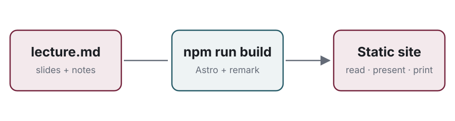

::slide{.title}

# Using These Slides

A tour of the lecture format

:::notes
Every lecture on this site is **one Markdown file**. The same file gives you
three things:

1. a slide deck you can present full screen,
2. a reading view where each slide sits next to notes like these, and
3. a printable handout (just print the page).

This lecture is a working demo of the format. Open
`src/content/lectures/00-using-these-slides.md` next to it to see how each
slide is written.
:::

---

## Three ways to use a lecture

::::columns
:::column
### Read
Scroll through slides and notes. Switch between **stacked**, **side by side**
and **grid** in the toolbar.
:::
:::column
### Present
Press :kbd[P] to present from the slide in view. :kbd[Esc] brings you back to
the same place in the page.
:::
:::column
### Presenter view
Press :kbd[S] for a second window with notes, the next slide and a timer.
Both windows stay in sync.
:::
::::

:::notes
The reading view and the presentation are the *same page*. Scrolling keeps
track of which slide is in view, so **Present** always starts where you are,
and leaving the presentation scrolls the page to wherever you stopped.

A typical setup in class: the audience window is full screen on the
projector, and the presenter view is on the laptop screen. A clicker that
sends Page Up / Page Down or arrow keys works in either window.
:::

:::speaker
This box is a *speaker note*. It only shows in presenter view (or press N in
the reading view). Use it for reminders you don't want students to read.
:::

---

## Writing a slide

```md
## Slide title

- Bullet points, **bold**, `code`, links...

:::notes
Notes for students: shown under the slide when
reading and in the presenter view.
:::

---

## The next slide
```

:::notes
Slides are separated by a line containing only `---`. Everything up to the
next `---` belongs to one slide, including its notes.

- `:::notes` … `:::` holds the student-facing notes for that slide.
- `:::speaker` … `:::` holds notes only you see.
- The first heading on a slide becomes its title in the slide list.
:::

---

## Revealing things step by step

:::steps
- Wrap content in `:::steps` and its items appear one at a time
- Each press of :kbd[→] or :kbd[Space] reveals the next item
- Going back hides them again
- In the reading view everything is visible
:::

:::notes
Inside `:::steps`, each list item is a step. Other blocks inside it (a
paragraph, a code block, a callout) are a step each. You can also add
`{.step}` to any directive, for example `:::callout{.step}`, to make that one
block appear on its own.

In presenter view, steps that aren't shown yet are dimmed, and the next one
is outlined.
:::

---

::slide{.section}

## Building blocks

Code, math, columns, callouts, images

:::notes
A **section** slide (`::slide{.section}`) marks the start of a new part of the
lecture. It shows up in bold in the slide list on the left.
:::

---

## Code

```python {2}
def binary_search(xs, target):
    lo, hi = 0, len(xs) - 1
    while lo <= hi:
        mid = (lo + hi) // 2
        if xs[mid] == target:
            return mid
        if xs[mid] < target:
            lo = mid + 1
        else:
            hi = mid - 1
    return -1
```

:::notes
Code blocks are highlighted at build time, so they look right without
JavaScript and work offline. The slide's code colours follow the slide theme;
code in the notes follows the site's light/dark mode:

```python
print(binary_search([1, 3, 5, 7], 5))  # 2
```

Keep slide code short. About 12–14 lines fit comfortably. Use
`::slide{.dense}` for a bit more room.
:::

---

## Math

The running time satisfies

$$
T(n) = T\!\left(\tfrac{n}{2}\right) + O(1) \quad\Longrightarrow\quad T(n) = O(\log n)
$$

Inline math works too: $\sum_{i=1}^{n} i = \frac{n(n+1)}{2}$.

:::notes
Math uses LaTeX between `$…$` (inline) or `$$…$$` (display) and is rendered
with KaTeX at build time.
:::

---

## Columns and callouts

::::columns{.wide-left .middle}
:::column
- `::::columns` holds two or more blocks; each one is a column
- Add `.wide-left` or `.wide-right` for a 60/40 split
- Add `.middle` to centre them vertically
:::

:::callout[Tip]
The outer block needs **more colons** than the blocks inside it.
:::
::::

:::callout[Watch out]{.warn}
Close every block with the same number of colons it opened with.
:::

:::notes
Each block directly inside `::::columns` is one column. Use `:::column` to
group several things (a heading and a list, say) into one column. Nesting
three levels deep needs five, four and three colons, so keep it shallow.

Any `:::name` block becomes an HTML `<div class="name">`, so a new building
block is just a CSS rule (add your own file with the `customCss` option).
Ones already styled:
`columns`/`column`, `steps`, `callout` (and `callout{.warn}`), `center`,
`fill` (fills the remaining space, good for a diagram), `bottom`, `muted`,
`big`.
:::

---

## Images and diagrams

:::fill

:::

:::notes
Put images next to the lecture in `src/content/lectures/images/` and link to
them with a relative path. Wrapping an image in `:::fill` makes it use all the
space left on the slide.

**Alt text matters:** it's what screen readers announce and what shows if the
image fails to load.
:::

---

::slide{.statement}

One line at the top of a slide changes its whole layout. This one is a *statement*.

:::notes
Layouts: `title`, `section`, `center`, `statement`, `dense`, `xdense`,
`big-text`, `image`.

Set a layout with `::slide{.name}` on the first line of the slide. You can
combine them, for example `::slide{.center .dense}`, and add `.no-footer` to
hide the slide number.
:::

---

:::notes
### Notes-only sections

This block has notes but no slide. It appears in the reading view (and the
handout) but is **skipped while presenting**. Use it for readings, longer
derivations, or anything that is better read than shown.

To make one, write a `:::notes` block on its own between two `---` lines.
:::

---

## Keyboard shortcuts

| Key | Action |
|---|---|
| :kbd[P] / :kbd[Esc] | Start / stop presenting |
| :kbd[S] | Presenter view |
| :kbd[→] :kbd[←] | Next / previous step |
| :kbd[↓] :kbd[↑] | Next / previous slide |
| :kbd[F] / :kbd[B] | Full screen / black screen |
| 12 :kbd[Enter] | Go to slide 12 |
| :kbd[?] | All shortcuts |

:::notes
While reading: :kbd[1] :kbd[2] :kbd[3] switch layout, :kbd[J] / :kbd[K] jump
between slides, and :kbd[N] shows speaker notes inline.
:::

---

::slide{.center}

## Questions?

<small>Next: add your first lecture by copying the lecture template from the package's `templates/` folder</small>
